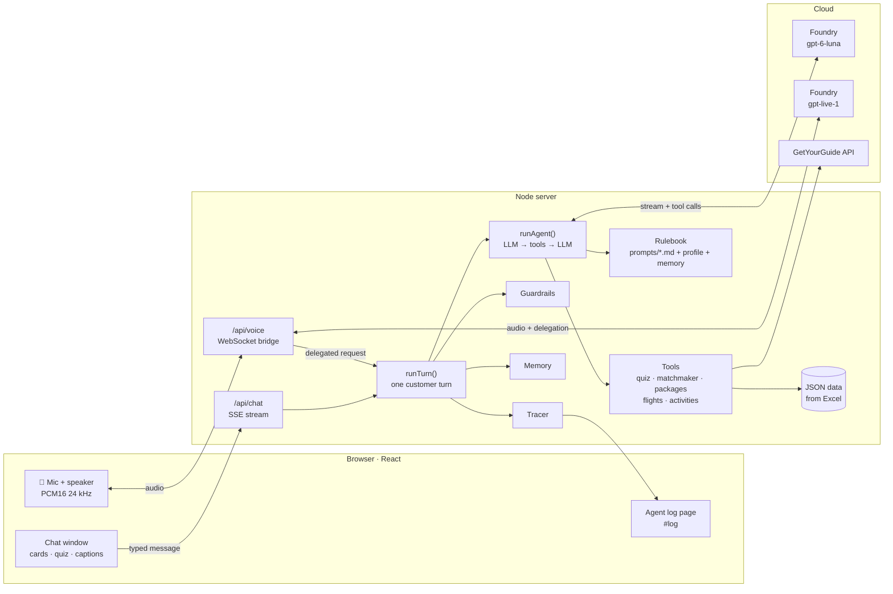
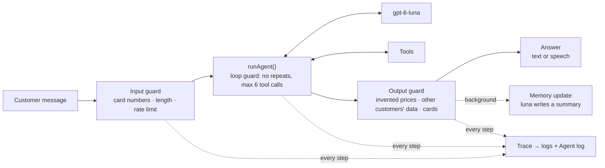
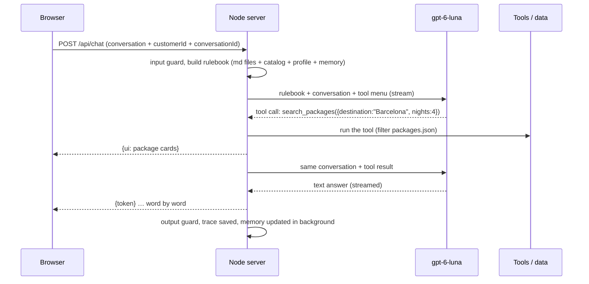
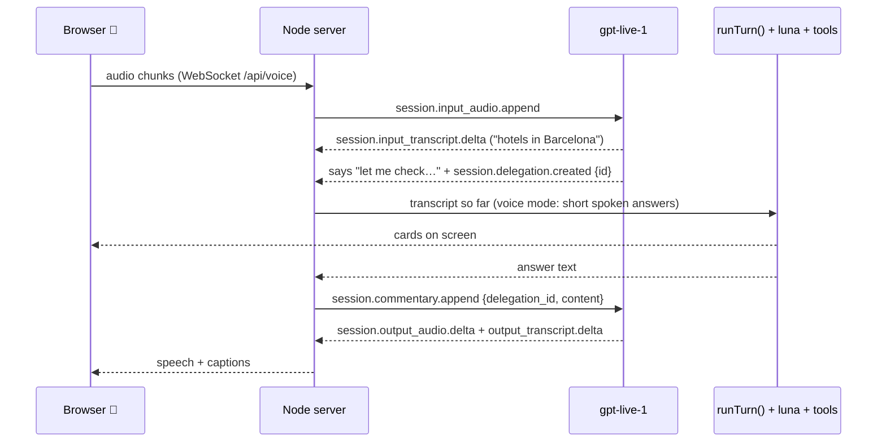
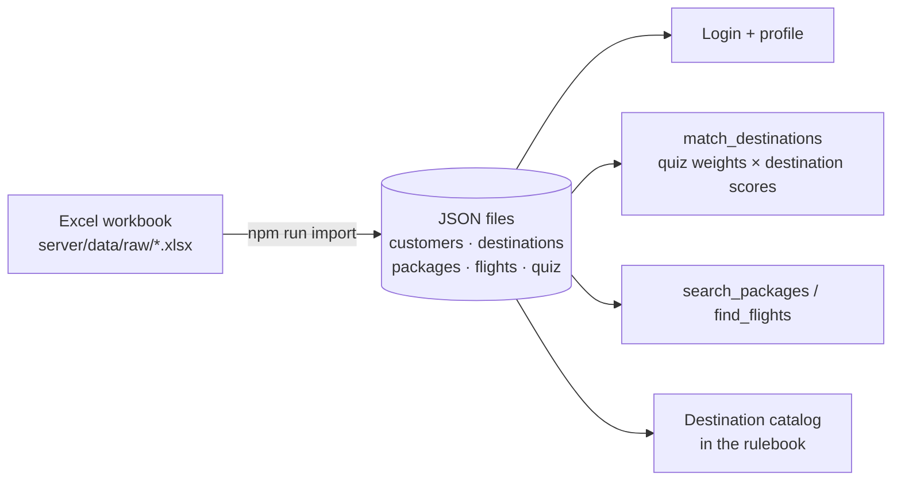

# Holiday Assistant — AI travel agent (voice + text)

A prototype AI travel agent that helps customers find and book **flight + hotel packages** and
**activities**, by chat or by voice. It reads the customer's mood, matches destinations with real
scoring data, searches packages and flights, adds GetYourGuide activities, and remembers members
between visits.

> **Prototype / learning project.** The repository contains no customer data and no API keys.

| | |
|---|---|
| **Front end** | React (Vite) — chat, mood quiz, cards, 🎤 voice, Agent log page |
| **Back end** | Node.js (Express) — agent loop, tools, guardrails, tracing, memory |
| **Brain** | `gpt-6-luna` on Microsoft Foundry (OpenAI-compatible Chat Completions, tool calling) |
| **Voice** | `gpt-live-1` on Microsoft Foundry (full-duplex voice, client delegation) |
| **Activities** | GetYourGuide Partner API |
| **Data** | Excel workbook → JSON (customers, destinations, packages, flights, mood quiz) |

---

## Architecture

### System overview



### One turn: what happens to a message

Every message — typed, spoken or from the test runner — goes through the same `runTurn()`:



### Typed message (text chat)



### Spoken message (voice, client delegation)

GPT-Live-1 is the ears and the voice. It cannot call tools, so it **delegates** to the same agent
used by the text chat:



### Data pipeline



More diagrams, including a target **enterprise architecture on Azure**, are in
[docs/architecture.md](docs/architecture.md).

---

## Agent harness

Everything around the model that makes it reliable:

| Part | File | What it does |
|---|---|---|
| **Rulebook** | `server/prompts/*.md` | Persona, mood, booking flow, rules, member vs guest, when to use which tool. Re-read on every message — edit and save, no restart. |
| **Tools** | `server/src/tools/` | `show_mood_quiz`, `match_destinations`, `search_packages`, `find_flights`, `find_activities` |
| **Agent loop** | `server/src/agent.js` | Calls the LLM, runs requested tools, feeds results back, repeats (max 6 rounds) |
| **Tracing** | `server/src/trace.js` | Records every LLM round, tool call, guardrail and token count → `server/logs/*.jsonl` + Agent log page |
| **Tests (evals)** | `server/evals/cases.json`, `server/scripts/run-evals.js` | Test conversations checked automatically: tool choice, arguments, wording, no invented prices, guardrails, memory |
| **Guardrails** | `server/src/guardrails.js`, `server/src/turn.js` | Input: card numbers removed, length cut, rate limit. Loop: no repeated or excess tool calls. Output: invented prices, other customers' data and card numbers removed. |
| **Memory** | `server/src/memory.js` | Members only: luna keeps a short summary per conversation; the last 3 are added to the rulebook on the next visit. `GET/DELETE /api/memory/:id`. |

---

## Getting started

**Requirements:** Node.js 18+, a Microsoft Foundry (or OpenAI-compatible) deployment with tool calling,
optionally a `gpt-live-1` deployment for voice and a GetYourGuide API key.

```bash
git clone <this repo>
cd travel-ai-voice-agent
npm run install:all
cp server/.env.example server/.env     # then fill in your endpoints and keys
```

**Data:** put your Excel workbook in `server/data/raw/` and run

```bash
npm --prefix server run import
```

Without it, the app starts with two made-up sample customers (`C90001`, `C90002`) but no packages or
flights. The workbook needs the sheets `Customer_Data`, `booking_data`, `Destination_Master`,
`Holiday_Inventory`, `Flight_Inventory` and `Quiz_Attribute_Mapping`.

**Run** (from the project folder — starts server and client):

```bash
npm run dev
```

Open http://localhost:5174 · Agent log: http://localhost:5174/#log · Health: http://localhost:3002/api/health

### Configuration (`server/.env`)

| Variable | Meaning |
|---|---|
| `OPENAI_BASE_URL`, `OPENAI_API_KEY`, `OPENAI_MODEL` | The brain (e.g. `https://<resource>.openai.azure.com/openai/v1`, `gpt-6-luna`) |
| `LLM_REASONING_EFFORT` | `none` — required by some models to use tools on `/chat/completions` |
| `LIVE_ENDPOINT`, `LIVE_API_KEY`, `LIVE_MODEL`, `LIVE_VOICE` | Voice (`gpt-live-1`) |
| `GYG_API_KEY`, `GYG_LANGUAGE`, `GYG_CURRENCY` | GetYourGuide activities (falls back to package data without a key) |
| `MEMORY_RETENTION_DAYS` | How long member memory is kept (default 365) |

### Scripts

| Command | Where | What |
|---|---|---|
| `npm run dev` | project folder | Start server + client |
| `npm run eval` | `server/` | Run all test conversations (`-- member` to filter, `--repeat 3` to repeat) |
| `npm run import` | `server/` | Excel → JSON |

---

## Project structure

```
travel-ai-voice-agent/
├── client/                    React app (port 5174)
│   └── src/
│       ├── Welcome.jsx        login (email / customer ID) or guest
│       ├── Chat.jsx           chat, cards, 🎤 voice, conversation ID
│       ├── voice.js           mic capture + audio playback
│       ├── LogViewer.jsx      Agent log (#log)
│       └── cards/             quiz, matches, packages, activities
├── server/                    Node API (port 3002)
│   ├── prompts/               the rulebook (md) + voice/ rules
│   ├── src/
│   │   ├── index.js           routes: /api/chat, /api/logs, /api/memory, /api/identify
│   │   ├── voice.js           GPT-Live-1 bridge + delegation
│   │   ├── turn.js            one turn: guards → agent → guards → memory
│   │   ├── agent.js           agent loop + loop guard
│   │   ├── llm.js             streaming Chat Completions client
│   │   ├── guardrails.js      input / output checks
│   │   ├── trace.js           tracer
│   │   ├── memory.js          member memory
│   │   └── tools/             tool definitions + implementations
│   ├── evals/cases.json       test conversations
│   ├── scripts/               import-excel.js, run-evals.js
│   └── data/                  JSON data (generated, not committed) + raw/
└── docs/architecture.md       diagrams incl. enterprise target on Azure
```

---

## Security and privacy notes

- **Never commit `server/.env`.** It is in `.gitignore`.
- Logs (`server/logs/`) and member memory (`server/data/memory/`) contain personal data and are not committed.
  Before real use: retention limits, access control, consent and a privacy review (GDPR).
- Card numbers are removed before they reach the LLM or the logs, but payments must never happen in the chat.
- The login is a demo (email or customer ID, no password). A real deployment needs proper authentication.
