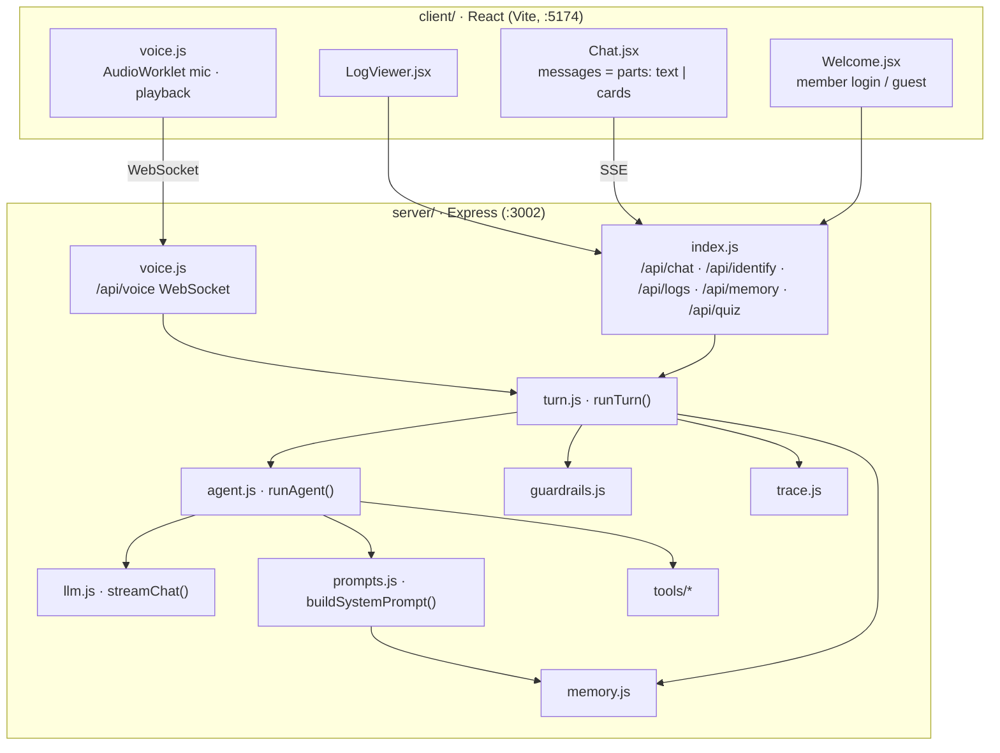
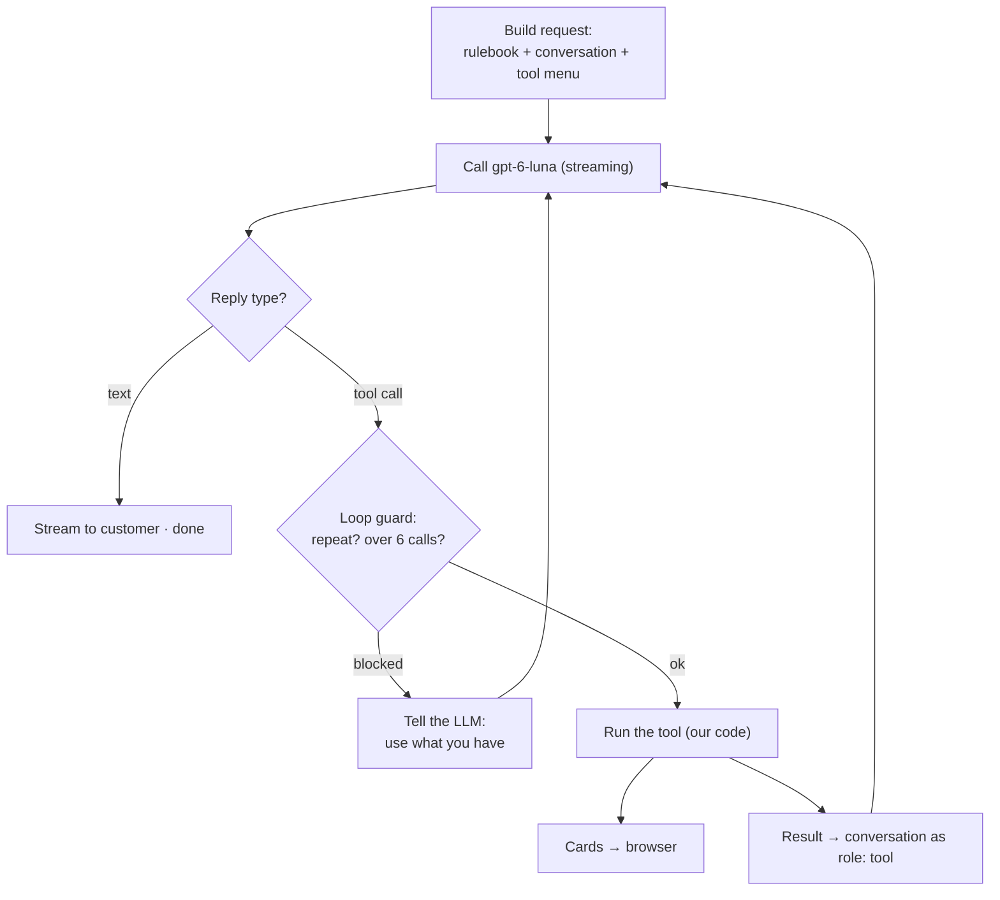
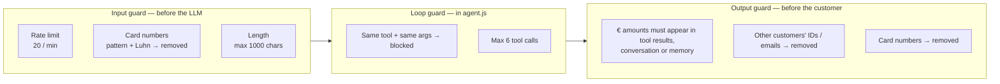
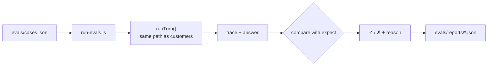
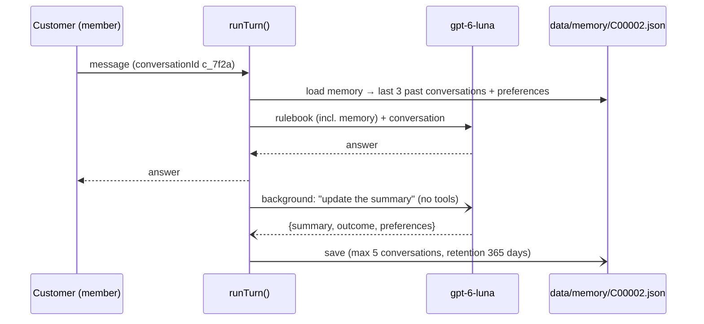
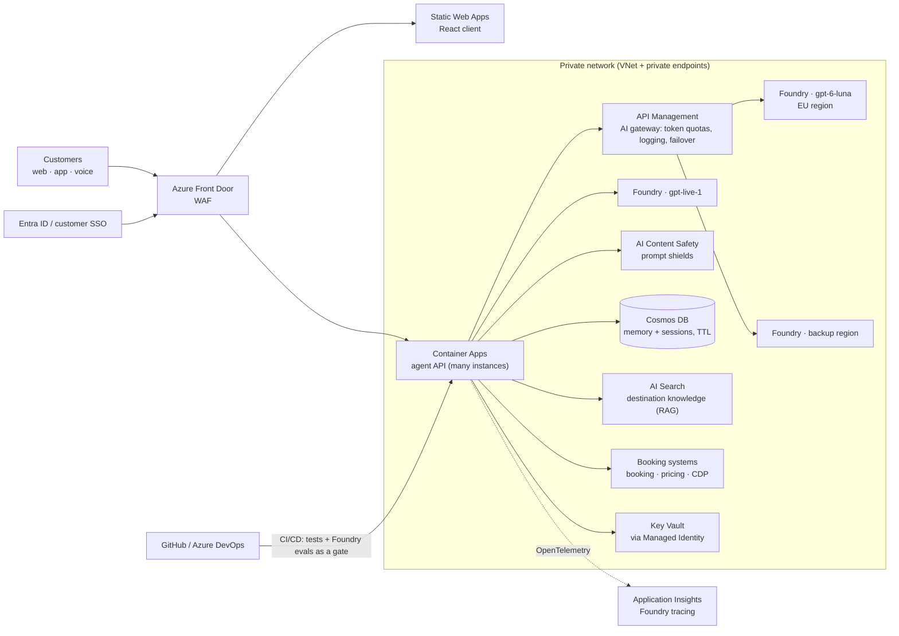

# Architecture

1. [Components](#1-components)
2. [The agent loop](#2-the-agent-loop)
3. [Tools and data](#3-tools-and-data)
4. [Guardrails](#4-guardrails)
5. [Tracing and the Agent log](#5-tracing-and-the-agent-log)
6. [Tests (evals)](#6-tests-evals)
7. [Memory](#7-memory)
8. [Voice](#8-voice)
9. [Target: enterprise architecture on Azure](#9-target-enterprise-architecture-on-azure)

---

## 1. Components



The browser keeps the conversation and sends it with every message; the server is stateless
apart from logs and memory files. Cards never pass through the LLM: tools send them straight to the browser.

---

## 2. The agent loop



- The LLM only **chooses** a tool and fills in its parameters (JSON Schema in `tools/index.js`).
- Our code **runs** the tool. At most 6 rounds per message.
- The rulebook (`prompts/*.md`, destination catalog, profile, memory) is sent with **every** request:
  the model keeps no state between calls.

---

## 3. Tools and data

| Tool | Reads | Returns |
|---|---|---|
| `show_mood_quiz` | quiz.json | 3 questions × 4 answers (card) |
| `match_destinations` | quiz.json, destinations.json, packages.json, profile | Top destinations with match %: Σ(mood weight × destination score), adjusted for season, budget, travel party and upcoming bookings |
| `search_packages` | packages.json | Hotels, stars, board, nights, price, availability |
| `find_flights` | flights.json | Flight departure dates (+ return date from nights) |
| `find_activities` | GetYourGuide `/1/tours` (fallback: packages.json) | Activities with photo, rating, price, link |

---

## 4. Guardrails



The md rules *ask* the model to behave; the guardrails *enforce* it in code. They are plain text checks —
no LLM, no tool calls. Text answers are corrected after streaming (`{replace}` event);
voice answers are checked before they are spoken. Limits are at the top of `guardrails.js`.

---

## 5. Tracing and the Agent log

One trace per customer turn, appended as one JSON line to `server/logs/YYYY-MM-DD.jsonl`:

```json
{ "channel": "voice", "conversation": "c_7f2a", "customer": "C00002 Anton",
  "input": "Show me hotels in Barcelona",
  "steps": [
    { "type": "llm",   "round": 1, "ms": 1200, "decision": "tool: search_packages" },
    { "type": "tool",  "name": "search_packages", "args": { "destination": "Barcelona" }, "ms": 8 },
    { "type": "llm",   "round": 2, "ms": 1800, "decision": "answer" },
    { "type": "guard", "name": "invented_price", "detail": "removed €199" }
  ],
  "tokens": { "total": 4830 }, "output": "…", "ms": 3100 }
```

Logs are for developers only — they are never sent back to the LLM.

---

## 6. Tests (evals)



Checks: `tools`, `anyTools`, `notTools`, `noTools`, `toolArgs`, `contains`, `notContains`, `containsAny`,
`containsAnyWord`, `maxRounds`, `maxSeconds`, `noInventedPrices`, `guards`, `noGuards`.
Cases with `"unit": "output"` test the output guard directly (no LLM, instant).
Tests never read or write real member memory.

---

## 7. Memory



Guests have no memory. `GET /api/memory/:id` shows it, `DELETE /api/memory/:id` erases it.

---

## 8. Voice

- Browser ⇄ `/api/voice` (our server) ⇄ `wss://<resource>/openai/v1/live/sessions` (gpt-live-1).
  The API key stays on the server.
- Audio: mono PCM16, 24 kHz, base64, about 100 ms chunks.
- Session start: instructions from `prompts/voice/live.md` + customer name, `delegation: { type: "client" }`.
- On `session.delegation.created`, the server runs `runTurn()` with `prompts/voice/backend-voice-mode.md`
  (short spoken answers), then sends `session.commentary.append` with the same `delegation_id`.
- Transcripts (`session.input_transcript.delta`, `session.output_transcript.delta`) become chat bubbles.

---

## 9. Target: enterprise architecture on Azure

How this prototype maps to a production setup. Not built — a roadmap.



| Prototype | Enterprise |
|---|---|
| `.env` keys | Key Vault + Managed Identity |
| Direct Foundry calls | API Management AI gateway |
| JSON files | Booking & pricing APIs, Azure SQL / Cosmos DB, AI Search |
| Memory files | Cosmos DB (partition per customer, TTL retention, consent) |
| `.jsonl` logs | OpenTelemetry → Application Insights / Foundry tracing |
| Regex guardrails | Same checks + Azure AI Content Safety |
| `npm run eval` by hand | Foundry evaluations in CI/CD, release gate, production monitoring |
| md files on disk | Versioned prompts, reviewed via pull request or a central prompt store |
